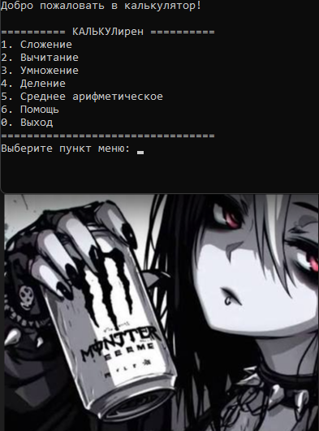

## Квест 1

# Калькулятор на Python
## Возможности программы
### Математические операции

## Квест 2

Калькулятор предназначен для выполнения основных математических операций.
Программа работает в консольном режиме и управляется через текстовое меню.

Пользователь может выполнять вычисления с двумя числами или рассчитывать
среднее арифметическое списка чисел.

## 3 Квест

**Текст как разработчик**

*Вайб такой щас*

⠄⠄⠄⠄⠄⡇⠄⠄⠄⠄⠄⢠⡀⠄⠄⢀⡬⠛⠁⠄⠄⠄⠄⠄⠄⠄⠉⠻⣿⣿⣿⣽⣿⣿⣿⣿⣿⣿⣿⣿⣧⠄⠄⠙⢦
⠄⠄⠄⠄⠄⡇⠄⠄⠄⠄⢰⠼⠙⢀⡴⠋⠄⠄⠄⠄⠄⠄⠄⠄⠄⡠⠖⠄⠄⠙⠿⢿⣿⣿⣿⣿⣿⣿⣿⣿⣯⣀⡀⠄⠄⠄⡀
⠄⠄⠄⠄⠄⡇⠄⠄⠄⠄⠄⠄⡴⠋⠄⠄⠄⠄⠄⠄⠄⠄⠄⢠⠞⠄⠄⠄⠄⠄⠄⠄⠄⠄⠉⠉⠉⠙⠋⠙⠋⠙⠻⠦⠤⣤⣼⣆⣀⣀⣀⣀⡀
⠄⠄⠄⠄⠄⢷⠄⠄⠄⠄⢠⠞⠄⠄⠄⠄⠄⠄⠄⠄⠄⠄⡰⠃⡄⠄⠄⠄⠄⠄⠄⠄⠄⠄⠄⠄⠄⠄⠄⠄⠄⠄⠄⠄⠄⠄⠄⠄⠄⠄⠄⠄⠉⠉⠉
⠄⠄⠄⠄⠄⢸⡀⠄⠄⢠⠏⠄⠄⠄⠄⠄⠄⠄⠄⠄⠄⣰⠁⣸⠁⠄⠄⠄⠄⠄⠄⠄⠄⢀⠄⠄⡄
⠄⠄⠄⠄⠄⢀⣧⠄⢠⠏⠄⠄⠄⠄⠄⠄⠄⠄⠄⢀⢾⠃⡜⡿⠄⠄⠄⠄⠄⠄⠄⠄⣠⠋⢀⣼⠁⠄⠄⠄⠄⠄⠄⠄⠄⠄⠄⠸⢾⣀⣠
⠄⠄⠄⢀⣠⢌⣦⢀⡏⠄⡄⠄⠄⢠⠃⠄⠄⠐⣶⡁⡞⡼⠄⣇⠄⠄⠄⠄⠄⠄⠄⡴⠁⢠⠎⢸⠄⠄⠄⠄⠄⠄⠄⠄⠄⠄⠄⠄⢈⠝⠁
⠄⢀⠞⠉⠄⠄⠹⡼⠄⣼⠁⠄⠄⡏⠄⠄⢀⡞⠄⠈⣷⠇⠄⢻⠄⠄⠄⠄⠄⢐⣞⣀⣰⣃⣀⣸⠄⢀⠇⠄⠄⠄⠄⠄⠄⠄⠄⠄⠁⠄⠄⠄⠄⠄⢀
⢰⠋⠄⠄⠄⠄⢀⡇⢠⡏⠄⠄⢸⠄⠄⢀⠎⠄⠄⠄⡇⠄⠄⢸⡀⠄⠄⠄⢠⢾⢁⡜⠁⠄⠄⢸⠄⣸⠄⠄⠄⠄⠄⠄⡀⠄⠄⠄⠄⠄⠄⠄⢀⡴⠃
⡞⠄⠄⠄⠄⠄⢸⠄⡞⡷⠄⠄⡟⠄⢘⡟⠛⠷⠶⣤⣅⠄⠄⠄⣇⠄⠄⢠⠋⡧⠊⠄⠄⠄⠄⢸⢀⠇⠄⠄⠄⠄⠄⢰⠁⠄⠄⠄⠄⠄⢀⡴⠋
⢹⠄⠄⠄⠄⠄⡾⢰⠃⡇⠄⠄⡇⠄⡜⢀⣠⣤⠶⠞⠛⠁⠄⠄⠘⡄⡰⠃⠘⠱⣾⣟⡛⠛⠛⠛⡟⠂⠄⠄⠄⠄⠄⡎⠄⠄⠄⠄⣀⠴⡋
⠈⢳⠄⠄⠄⠄⡇⡼⠄⢻⠄⢠⡇⢸⠁⠈⠁⠄⠄⠄⠄⠄⠄⠄⠄⠈⠁⠄⠄⠄⠄⠙⠿⣶⣄⡰⠇⠄⠄⠄⠄⠄⡼⠄⠄⠄⡠⢾⣿⣆⢳
⣀⣬⠿⠷⠦⠤⣷⣇⡠⠾⡄⢸⣇⢸⠄⠄⠄⠄⠄⠄⠄⠄⠄⠄⠄⠄⠄⠄⠄⠄⠄⠄⠄⠄⢹⠛⠂⠄⠄⠄⠄⣰⠁⠄⣀⣬⣷⠞⠛⠙⠛⢧⣤⣀
⠉⠄⠄⠄⠄⠄⢻⠄⠄⠄⢧⢸⢸⠘⡇⠄⠄⠄⠄⠄⠄⠄⠄⣠⠄⠄⠄⠄⠄⠄⠄⠄⠄⢠⠃⠄⠄⠄⠄⠄⣰⠃⣶⢉⠜⠋⠄⠄⠄⠄⠄⠄⠄⠈⢳
⠄⠄⠄⢀⣤⡀⢸⠄⠄⠄⠈⢿⠄⠄⣿⣆⠄⠄⠄⠄⠄⠄⠄⡟⣧⠄⠄⠄⠄⠄⠄⠄⡴⠃⠄⠄⠄⡠⠊⡰⡗⠋⡰⡼⠃⠄⠄⠄⠄⠄⠄⠄⠄⠄⢨
⠄⢀⡔⠉⠄⠙⢦⠄⠄⠄⠄⢸⡀⢰⡏⠈⠳⣄⠄⠄⠄⠄⠄⠉⠁⠄⠄⠄⠄⠄⢀⡞⠁⠄⢀⣤⠎⠄⡔⣡⠃⢰⡇⣹⠄⠄⠄⠄⠄⠄⠄⠄⠄⠄⢼
⣰⠋⠄⢀⣴⣖⠒⠓⡆⠄⠄⠈⣇⣿⣿⠄⢸⠹⡷⢄⠄⠄⠄⠄⠄⠄⠄⠄⠄⣠⠋⠄⢀⣴⣿⠏⠠⠊⣴⡏⢠⢻⡇⢹⡆⠄⠄⠄⠄⠄⣷⠄⠄⣰⠋
⡇⠄⣰⣿⣿⣿⠒⠋⣛⣄⠄⠄⣹⢸⠈⢧⠸⡄⠹⣄⠙⠶⢶⣶⣶⣶⣶⡶⢾⠃⠄⡴⢋⡾⠋⣀⡴⣞⡝⡰⠃⠄⡇⡸⠉⠳⣄⣀⣀⣀⣿⣦⠞⠁
⢷⢰⣿⣿⣿⣿⠄⠈⠁⠈⡇⠄⡏⢸⠄⠈⠓⢧⣀⣈⣤⡤⠖⠛⠉⠁⠄⢡⠃⢠⡞⠓⠚⠓⠚⣳⡞⠈⠘⠁⠄⠄⢹⡇⠄⠄⠄⠈⠉⠁⠸⣷⣀⣀⣀
⢸⣿⣿⣿⣿⣿⠄⣿⣁⠜⠁⢸⡇⢸⣄⣀⡀⠘⢦⡀⠄⠄⠄⠄⠄⠄⢀⠏⡴⡻⠄⠄⠄⠠⣎⠹⡄⠄⢀⣀⣤⣤⣀⠁⠄⠄⠄⠄⠄⠄⠄⠈⢻⣿⣿
⢸⣿⣿⣿⣿⣿⡇⢸⠄⠄⢀⡴⡇⠈⡇⠈⣩⠗⠒⣵⠆⠄⠄⠄⠄⠄⢸⡞⢰⠃⢀⠄⣀⡰⠟⠒⠒⡿⠉⠄⠄⠄⠈⠑⣄⠄⠄⠄⠄⠄⠄⠄⠈⢿⣿
⣿⣿⣿⣿⣿⣿⣷⠎⠄⢠⠏⠄⠹⣄⢣⢠⠃⠄⠄⢤⠤⠄⠄⠠⠤⢶⡏⠄⡎⢠⠞⠋⠁⠄⠄⠄⣸⠁⠄⠄⠄⠄⠄⠄⠈⣧⠄⠄⠄⠄⠄⠄⠄⠄⠻
⣿⣿⣿⣿⣿⣿⣃⡀⢠⠏⠄⠄⠄⠄⣨⠇⠄⣠⠴⠚⠁⠄⠄⠄⠄⠈⡇⢰⠃⠄⠄⠄⠄⠄⠄⢰⠇⠄⠄⠄⠄⠄⠄⠄⠄⢹⡀
⣿⣿⣿⣿⣿⡿⢉⣇⡎⠄⠄⠄⠄⢰⠇⠄⢨⠇⠄⠄⠄⠄⠄⠄⠄⠄⠘⢾⡀⠄⠄⠄⠄⠄⠄⡞⢀⠄⠄⠄⠄⠄⠄⠄⠄⢸⡇

~~Сон у студента пишущего ИТвПД~~

## 4 Квест

- Основные операции:
  - Сложение
  - Вычитание
  - Умножение
  - Деление
- Дополнительная функция:
  - Среднее арифметическое

## 5 Квест

1. Запустить калькулятор.
2. Выбрать нужную операцию.
3. Ввести необходимые числа.
4. Получить результат вычислений.

## 6 Квест

- [x] Создан файл main.py
- [x] Добавлены математические операции
- [x] Реализована обработка ошибок
- [ ] Подготовка дополнительной документации

## 7 Квест

| Пункт меню | Операция | Назначение |
|---|---|---|
| 1 | Сложение | Сложение двух чисел |
| 2 | Вычитание | Вычитание второго числа из первого |
| 3 | Умножение | Умножение двух чисел |
| 4 | Деление | Деление первого числа на второе |
| 5 | Среднее арифметическое | Расчёт среднего значения |
| 6 | Помощь | Отображение справки |
| 0 | Выход | Завершение программы |

## 8 Квест

[Моя Операционная Система](https://github.com/Vitlikxbox/FurrOS)

[Исходный код калькулятора](../main.py)

## 9 Квест

Для запуска программы необходимо выполнить команду `python main.py`.

## 10 Квест

```bash
python main.py
python -m unittest -v
```

## 11 Квест

> Калькулятор предназначен для выполнения основных
> математических операций.

## 12 Квест


